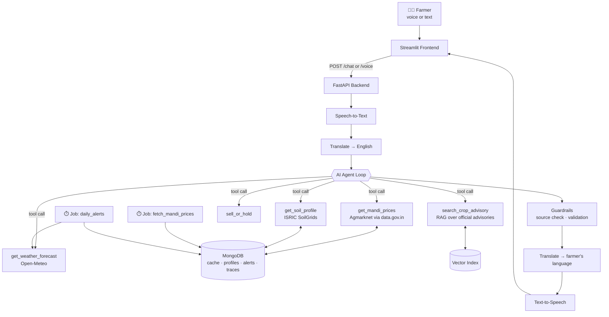

# 🌾 Krishi Mitra — Multilingual AI Farm Advisor

> A voice-first AI agent that gives farmers crop-level advice in their own language, grounded in **live** weather forecasts, mandi prices, and soil data — with every number cited to its source.

**Forge Gen AI Buildathon · Theme 2: Climate, Resource Infrastructure & Global Supply Resilience**
**Problem Statement:** Multilingual Agritech & Resource Advisory Assistant

| | |
|---|---|
| 🔗 **Live App** | `<add deployed URL>` |
| 🎥 **Demo Video** | `<add video link>` |
| 📊 **Pitch Deck** | `<add deck link>` |

---

## 📌 Problem Statement

Small and marginal farmers make high-stakes decisions — when to sow, when to spray, when to harvest, where and when to sell — with fragmented information. Weather forecasts, mandi prices, and soil data exist on separate government and public platforms, mostly in English, and rarely translate into a clear action for a specific crop on a specific farm.

The result: crops harvested just before heavy rain, pesticide washed off by unexpected showers, and produce sold at the nearest mandi even when a market 30 km away pays more.

**Target audience:** small and marginal farmers in India, especially those more comfortable speaking a regional language than reading English, and the extension workers and FPOs who advise them.

---

## 💡 Solution

Krishi Mitra is an **AI agent**, not a static chatbot. When a farmer asks a question by voice or text, the agent:

1. Understands the question in the farmer's language and translates it.
2. **Plans which data it needs** and calls live tools — weather, mandi prices, soil, and official crop advisories.
3. Reasons over the combined data for the farmer's specific crop, location, and season.
4. Replies in plain language, in the farmer's language, as text and speech — **with the source and timestamp of every figure**.

### Key Features

- 🗣️ **Voice-first, multilingual** — ask and hear answers in Gujarati, Hindi, and other Indian languages.
- 🌦️ **Weather-aware protective advice** — e.g., "Rain of 40 mm expected Thursday; delay spraying and harvest your groundnut by Wednesday."
- 💰 **Sell-or-hold advisor** — compares today's modal price across nearby mandis with the recent trend and recommends sell now, wait, or sell at a better market.
- 🔔 **Proactive risk alerts** — a daily background job checks each registered farmer's forecast against their crop stage and pushes warnings without being asked.
- 📚 **Grounded crop calendars** — planting and harvesting schedules retrieved from official ICAR / state agriculture department advisories (RAG).
- 🔍 **Transparent reasoning** — an agent trace panel shows every tool call, its inputs, and its live result.

---

## 🏗️ Architecture



### How the agent works

The agent loop is written from scratch (no heavy framework) so that every step is inspectable:

1. The LLM receives the user's question, the farmer's profile (location, crops, language), and the tool schemas.
2. It returns either a final answer or one or more tool calls.
3. Tool calls are dispatched to the data-source modules; results (or structured errors) are fed back to the LLM.
4. The loop repeats until the LLM produces a final answer or a step limit is reached.
5. Guardrails check the answer before it is returned: numbers must trace back to tool outputs, and sources are attached.

### Resilience and edge cases

| Situation | Behaviour |
|---|---|
| data.gov.in API down or slow | Agent reads the most recent prices from the MongoDB cache and states the data's date |
| SoilGrids rate-limited or down | Soil data is cached permanently per location; if never fetched, the agent answers without soil data and says so |
| Unknown crop or misspelled district | Fuzzy matching + clarifying question instead of guessing |
| No mandi reports today for a commodity | Falls back to the latest available date and nearby markets, clearly labelled |
| LLM tries to state a figure no tool returned | Guardrail flags it; agent is re-prompted to use tool data only |
| Network timeout on any API | Shared HTTP helper retries with backoff, then returns a structured error the agent can explain |

---

## 🧰 Tech Stack

| Layer | Technology |
|---|---|
| Backend | Python, FastAPI |
| AI agent | LLM with native tool calling (`<model name>`), custom agent loop |
| RAG | Embeddings + MongoDB Atlas Vector Search over official advisory PDFs |
| Speech & translation | `<Sarvam AI / Bhashini>` |
| Database | MongoDB Atlas |
| Background jobs | APScheduler |
| Frontend | Streamlit |
| Deployment | `<Render / Railway>` (backend), Streamlit Community Cloud (frontend) |

---

## 📡 Data Sources (all live / official — no mock data)

| Data | Source | Access | Notes |
|---|---|---|---|
| Weather forecast | [Open-Meteo](https://open-meteo.com/) | Free, no API key | Hourly/daily rain, temperature, humidity, wind |
| Mandi prices | [Agmarknet](https://agmarknet.gov.in/) via [data.gov.in](https://data.gov.in/) | Free API key | Fetched on a schedule and cached with `source` and `fetched_at` |
| Historical price trends | CEDA Agri Market Data (Ashoka University) | API key | Used for sell-or-hold trend analysis |
| Soil properties | [ISRIC SoilGrids](https://rest.isric.org/) | Free, no key | Fair-use limit of 5 calls/minute; cached per location |
| Crop calendars & advisories | ICAR and state agriculture department publications | Public PDFs | Source documents in `knowledge_base/advisories/` |

Every record stored in the database carries a `source` and `fetched_at` field, and every figure shown to the farmer is cited.

---

## 📁 Project Structure

```
krishi-mitra/
├── backend/
│   ├── app/
│   │   ├── main.py              # FastAPI app entry point
│   │   ├── config.py            # Settings loaded from .env
│   │   ├── api/                 # HTTP endpoints: chat, voice, farmers, health
│   │   ├── agent/               # Agent loop, tool schemas, prompts, guardrails
│   │   ├── data_sources/        # Weather, mandi, soil, geocoding clients
│   │   ├── rag/                 # Advisory ingestion and retrieval
│   │   ├── language/            # Speech-to-text, text-to-speech, translation
│   │   ├── features/            # Sell-or-hold advisor, risk alerts
│   │   ├── db/                  # MongoDB connection and Pydantic models
│   │   └── utils/               # HTTP helper (timeouts/retries), logging
│   ├── jobs/                    # Scheduled mandi fetcher and daily alerts
│   ├── tests/                   # Tests against live APIs and agent behaviour
│   └── requirements.txt
├── frontend/
│   ├── streamlit_app.py         # Main UI
│   └── components/              # Chat view, agent trace panel, price chart
├── knowledge_base/advisories/   # Official advisory PDFs (source documents)
├── docs/                        # Architecture diagram, demo script
├── .env.example
└── README.md
```

---

## ⚙️ Setup & Installation

### Prerequisites

- Python 3.10+
- A MongoDB Atlas cluster (free tier works)
- API keys: LLM provider, data.gov.in, speech/translation provider (and optionally CEDA)

### 1. Clone the repository

```bash
git clone <repo-url>
cd krishi-mitra
```

### 2. Create a virtual environment and install dependencies

```bash
python -m venv venv
source venv/bin/activate        # Windows: venv\Scripts\activate
pip install -r backend/requirements.txt
```

### 3. Configure environment variables

```bash
cp .env.example .env
```

Fill in `.env`:

| Variable | Description |
|---|---|
| `LLM_API_KEY` | API key for the LLM provider |
| `LLM_MODEL` | Model name used by the agent |
| `DATA_GOV_IN_API_KEY` | data.gov.in API key for Agmarknet prices |
| `CEDA_API_KEY` | (Optional) CEDA key for historical price trends |
| `SPEECH_API_KEY` | Speech-to-text / text-to-speech / translation provider key |
| `MONGODB_URI` | MongoDB Atlas connection string |
| `MONGODB_DB` | Database name, e.g. `krishi_mitra` |
| `BACKEND_URL` | URL the frontend uses to reach the backend, e.g. `http://localhost:8000` |

### 4. Build the advisory knowledge base

```bash
cd backend
python -m app.rag.ingest
```

### 5. Run the backend

```bash
uvicorn app.main:app --reload
```

API docs are then available at `http://localhost:8000/docs`.

### 6. Start the background jobs (separate terminal)

```bash
cd backend
python -m jobs.fetch_mandi_prices
python -m jobs.daily_alerts
```

### 7. Run the frontend (separate terminal)

```bash
streamlit run frontend/streamlit_app.py
```

---

## 🔌 API Endpoints

| Method | Endpoint | Description |
|---|---|---|
| `POST` | `/chat` | Text question → answer, sources, and agent trace |
| `POST` | `/voice` | Audio question → audio answer, transcript, and agent trace |
| `POST` | `/farmers` | Register a farmer profile (location, crops, language) |
| `GET` | `/farmers/{id}/alerts` | Proactive alerts for a farmer |
| `GET` | `/health` | Status of each external data source |

---

## 🧪 Running Tests

```bash
cd backend
pytest tests/
```

Data-source tests call the real APIs and check the response shape, so they need valid keys and a network connection.

---

## 🗺️ Future Roadmap

- WhatsApp / Telegram bot interface, so farmers can use apps they already have
- IVR (phone call) access for feature phones
- Satellite vegetation indices (NDVI) for crop health monitoring
- Pest and disease identification from crop photos
- Integration with Soil Health Card data for farm-specific nutrient advice
- Support for more Indian languages and dialects

---

## 👥 Team

| Name | Role |
|---|---|
| `<name>` | `<role>` |
| `<name>` | `<role>` |
| `<name>` | `<role>` |

---

## 🙏 Acknowledgements

Weather data by [Open-Meteo](https://open-meteo.com/). Market prices from Agmarknet, Directorate of Marketing & Inspection, Government of India, via the [Open Government Data Platform India](https://data.gov.in/). Soil data from [ISRIC SoilGrids](https://www.isric.org/explore/soilgrids). Crop advisories from ICAR and state agriculture departments.
